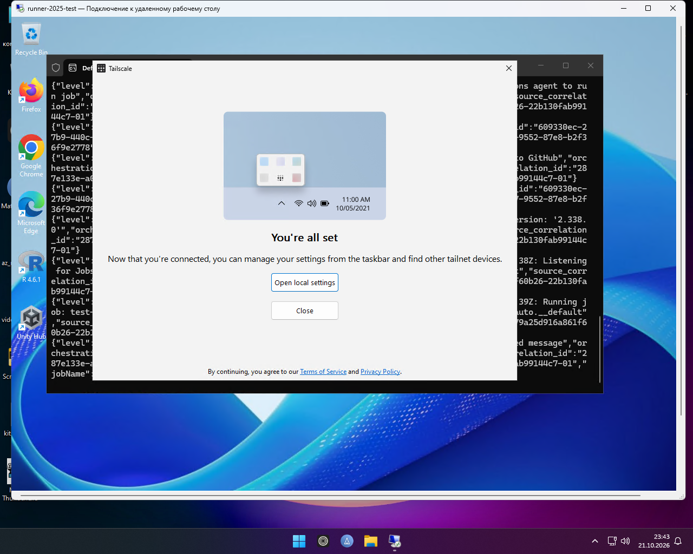

# Win RDP Enabler 🚀

A GitHub Action to instantly set up RDP and network connectivity via Tailscale on Windows GitHub Actions runners.

## Usage

Add this step to your Windows job workflow:

```yaml
      - name: Run Win RDP Enabler
        uses: Veniamin668/win-rdp-enabler@x64-oauth # (or arm-oauth)
        with:
           OAUTH_KEY: ${{ secrets.TAIL_OAUTH }} # if TAIL_KEY not use
           TAIL_KEY: ${{ secrets.TAIL_KEY }} # optional if not use OAUTH
           ADMIN_PASS: ${{ secrets.ADMIN_PASS }}
           USE_CUSTOM_USER: 'false'
           CUSTOM_USERNAME: ''
           CUSTOM_PASSWORD: ${{ secrets.CUSTOM_PASSWORD }}
           HOSTNAME: 'your-name-vm'
           ADVERTISE_TAGS: 'tag:runner'
```
### Available versions

* `arm-js` — Windows ARM64 runners
* `x64-js` — Windows x64 runners

Required Secrets
Go to your repository Settings -> Secrets and variables -> Actions and add:

`TAIL_KEY` — Your Tailscale Auth Key (optional)

`OAUTH_KEY` — Your Tailscale OAuth Key (optional)

`ADMIN_PASS` — Password for runneradmin (optional)

`CUSTOM_PASSWORD` — Password for your custom user if use-custom-user is enabled (optional)

`HOSTNAME` — Name runner , you can use any name for the runner. (optional)

`ADVERTISE_TAGS` — Your Tag for OAuth (optional)

### 👤 Custom User Options

- If `use-custom-user` is set to **`false`**, the action will use the default `runneradmin` account (and update its password if `ADMIN_PASS` is provided).
- If you want to create your own local admin, set `use-custom-user` to **`true`**, specify your desired name in `username`, and provide a password via `CUSTOM_PASSWORD`.


<details>
<summary><b>🖼️ Example RDP Works (Click, to expand)</b></summary>

<p align="center">
  
</p>

</details>
